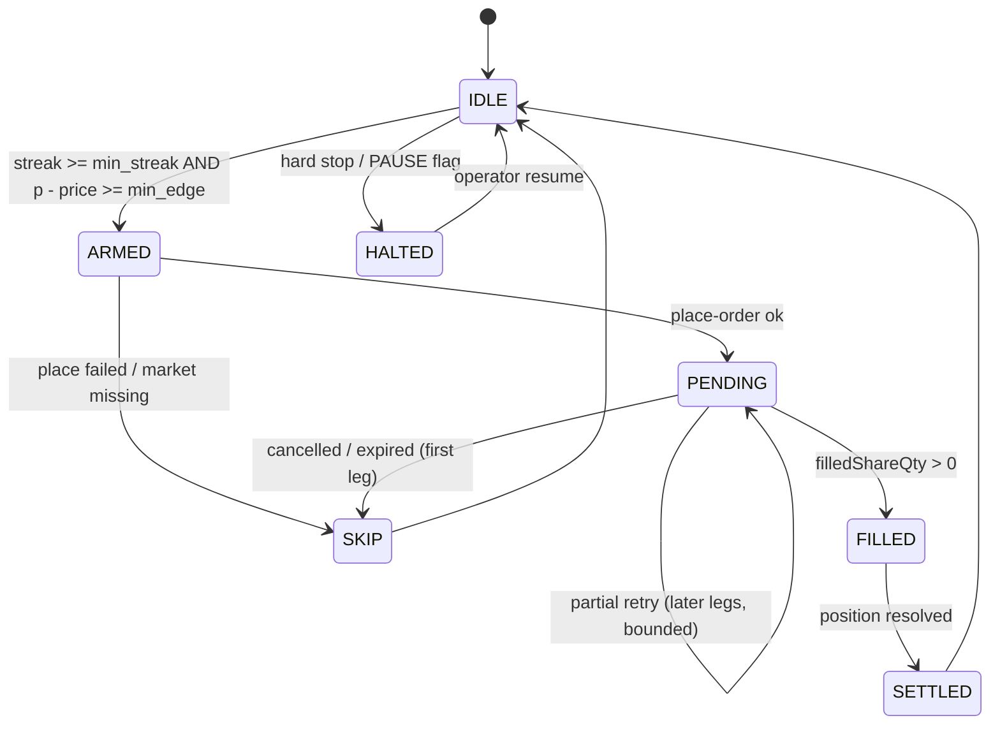

# State machine

## 1. States

| State | Meaning | Persisted as |
|---|---|---|
| `IDLE` | no signal, no position | `active=false, pending=null` |
| `ARMED` | signal accepted, round opening | `active=true, pending=null` |
| `PENDING` | order submitted, awaiting fill | `pending={orderId,...}` |
| `FILLED` | fill seen, waiting for round close | `pending.fill_notified=true` |
| `SETTLED` | WIN/LOSS resolved, ledger written | back to `IDLE` |
| `SKIP` | first leg unfilled or refused | back to `IDLE` |
| `HALTED` | hard stop or operator pause | `PAUSE` flag on disk |

## 2. Transitions

## 3. Invariants

1. **At most one `pending` per account.** `save_state()` is the only writer.
2. **A round is entered at most once.** `target_ot` is fixed at submission.
3. **A cycle number identifies exactly one cycle.** *Currently violated* — see R-07.
4. **A strategy never places an order while `hard_stop_active` is true.**
5. **Settlement must never default to LOSS when the payload is ambiguous.**
6. **Restart must resume, not re-enter.** *Partially violated* — see R-02.

## 4. Where the implementation diverges

| Invariant | Reality in `src/` | Impact |
|---|---|---|
| 1 | Holds in-process; two processes break it (no lock) | duplicate orders |
| 3 | `reset_cycle()` does not advance `cycle_count`, so a failed cycle reuses its number | 166 starts / 127 unique ids in the live log |
| 6 | `load_state()` falls back to a blank state on parse error | in-flight order forgotten |

These are tracked as R-02, R-04 and R-07 in the [risk register](risk-register.md).
